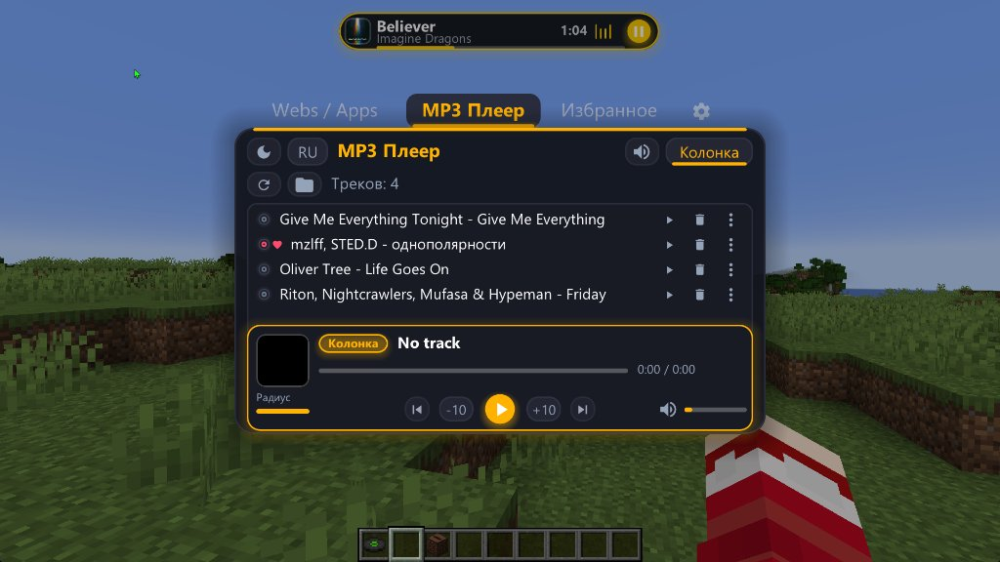
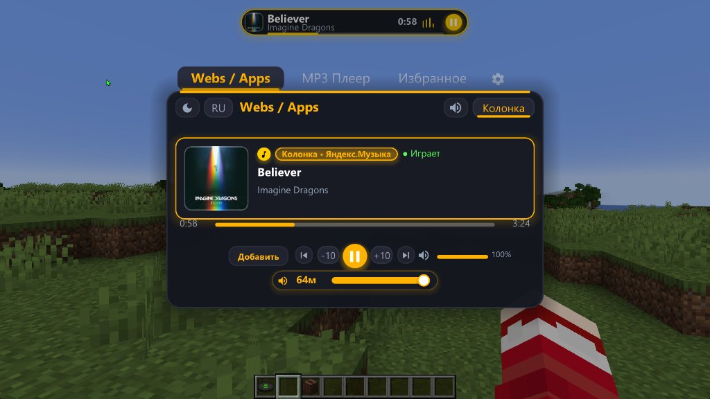

# 🎵 MP3 Player 2.0.0 (Port Minecraft 26.3 — Wilderness Bound)


**MP3 Player** адаптирован под новейшую версию **Minecraft 26.3 ("Wilderness Bound")** на базе **Fabric Loader** и **Java 25**. Все возможности версии 2.0.0 полностью сохранены: аппаратный векторный интерфейс NanoVG GL3, системный медиа-контроль Windows GSMTC, динамический HUD-оверлей («Золотая капсула»), 3D-колонка в мире, голограммы над джукбоксами и запись виниловых пластинок.

---

## 📸 Скриншоты интерфейса 2.0.0

| Главное меню плеера и плейлист | Интеграция с внешними плеерами (GSMTC) |
| :---: | :---: |
|  |  |

---

## 🛠 Особенности порта на Minecraft 26.3

Minecraft 26.3 совершил фундаментальный переход на новый конвейер рендеринга **RenderPearl** (заменивший легаси Blaze3D / GlStateManager), обновил сетевую подсистему и среду выполнения Java до **Java 25**:

1. **Интеграция NanoVG с RenderPearl & OpenGL 3:**
   - Прямой вызов FBO через LWJGL OpenGL 30 (`GL30.glBindFramebuffer`).
   - Изоляция состояния семплеров текстур (`glBindSampler(0..31, 0)`), спасающая от конфликтов с шейдерными семплерами RenderPearl.
   - Сброс `GL_PIXEL_UNPACK_BUFFER` и `GL_UNPACK_ALIGNMENT = 1` при генерации атласа шрифтов и иконок.

2. **Обновлённая графическая система GUI (`GuiGraphicsExtractor`):**
   - Перевод экранов `MainScreen`, `MusicDiscScreen`, `ShareScreen`, `ShareRequestScreen` на `extractRenderState` и `extractBackground`.
   - Использование встроенного `GuiGraphicsExtractor.centeredText()` и прямого шейдерного рендера скинов игроков.

3. **In-World 3D-голограммы (`LevelRenderEvents.END_MAIN`):**
   - Перевод мирового рендеринга вращающихся дисков и голограмм над головами игроков и джукбоксами на `SubmitNodeCollector` (`submitText`, `itemState.submit`).
   - Использование нового API трансформаций `PoseStack.rotate(Quaternionfc)` и `PoseStack.rotateDegrees(Axis, angle)`.

4. **Fabric Networking API v1 (6.4.0+):**
   - Регистрация C2S/S2C пакетов через `PayloadTypeRegistry.serverboundPlay()` и `PayloadTypeRegistry.clientboundPlay()`.
   - Поддержка серверных предсказаний `Prediction.SERVER_ONLY` при возврате пластинок в инвентарь игрока.

---

## ✨ Возможности мода

* **🎧 Локальный аудиоплеер:** Воспроизведение `.mp3` и `.wav` файлов из папки `.minecraft/mp3player` со встроенной автоматической конвертацией через FFmpeg.
* **🌐 Windows GSMTC (Webs / Apps):** Прямой перехват музыки из Яндекс.Музыки, Spotify, VK Музыки, YouTube Music и браузеров с отображением оригинальных обложек альбомов.
* **💊 HUD-оверлей («Золотая капсула»):** Компактный плавающий виджет поверх игрового экрана с обложкой, названием, анимированным эквалайзером и кнопками управления.
* **🔊 Режим «Колонка»:** 3D-вещание треков окружающим игрокам на сервере с затуханием звука по дистанции.
* **💿 Кастомные виниловые пластинки:** Запись любимых треков на пластинки и воспроизведение в джукбоксах.
* **🔄 P2P-передача треков:** Мгновенный обмен файлами прямо в игре с игроками рядом.

---

## ⌨️ Управление

* **Правый Shift (Right Shift):** Открыть / закрыть главное меню плеера.
* **P:** Пауза / Возобновление воспроизведения.
* **] / [ :** Следующий / Предыдущий трек.

---

## 📦 Сборка из исходников

```bash
# Клонировать репозиторий и переключиться на ветку 26.3
git clone https://github.com/zabugorniyhuy-max/mp3player.git -b 26.3
cd mp3player

# Собрать jar-мод (требуется Java 25)
./gradlew build
```

Собранный файл мода будет находиться в `build/libs/mp3player-26.3.jar`.
